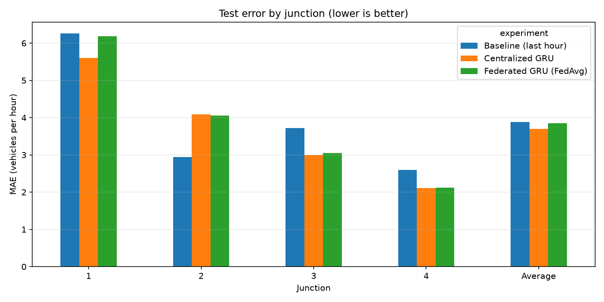
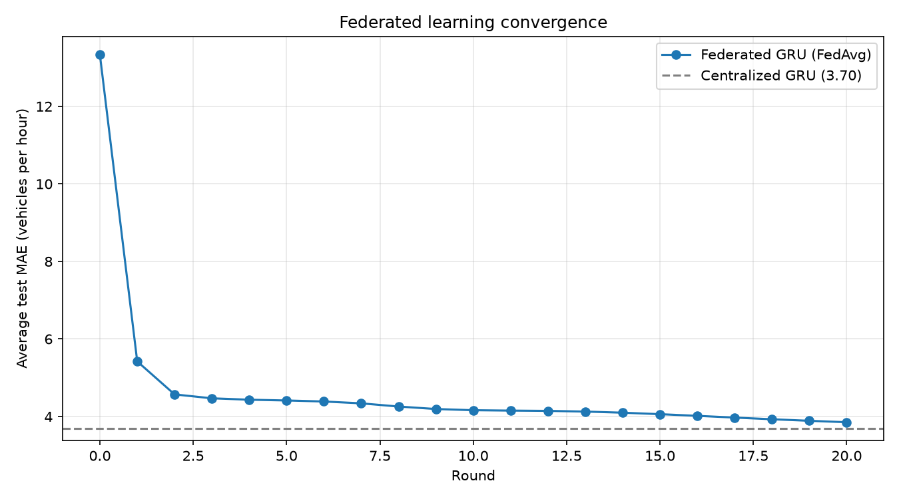
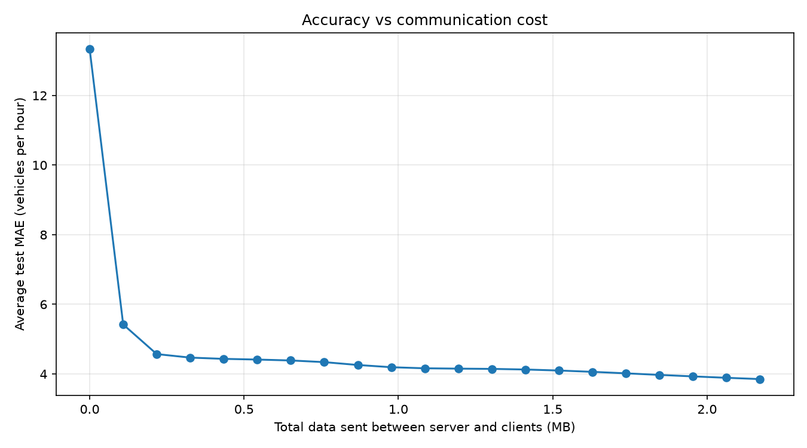

# Federated Traffic Forecasting with Flower

Predicting hourly traffic at 4 road junctions with a GRU neural network, trained **federated** (each junction keeps its own data) with [Flower](https://flower.ai), and compared with normal **centralized** training.

**Research question:** If 4 junctions can't share their raw data, how close can federated learning get to a model trained on all the data in one place?



## Results

Test error (MAE = average mistake in vehicles per hour, lower is better):

| Junction | Baseline (last hour) | Centralized GRU | Federated GRU (FedAvg) |
|---|---|---|---|
| 1 | 6.26 | 5.60 | 6.18 |
| 2 | 2.94 | 4.09 | 4.06 |
| 3 | 3.72 | 3.00 | 3.05 |
| 4 | 2.60 | 2.11 | 2.12 |
| **Average** | **3.88** | **3.70** | **3.85** |

**Key findings**

- **Federated learning came within about 4% of centralized training** (average MAE 3.85 vs 3.70) without any junction sharing its data.
- At **Junctions 2, 3 and 4**, federated and centralized results are nearly identical.
- The biggest gap is at **Junction 1**, the busiest junction (6.18 vs 5.60). In FedAvg, each client's update is weighted by its amount of data, and all clients are averaged into one shared model. The busiest, most variable junction may be the one that suffers most from this compromise. This is an effect of **non-IID data** (each junction's traffic looks very different).
- The GRU beat the simple "same as last hour" baseline at 3 of 4 junctions, but **not at Junction 2**. My hypothesis is that traffic grows over time (the test period is the newest and busiest data), and that Junction 2 changes smoothly from hour to hour, which makes the baseline strong.
- The federated error was **still decreasing at round 20**, so more rounds would likely close more of the gap.

### Convergence and communication cost





The GRU has about 3,400 weights (about 0.014 MB). Each round, all 4 clients download and upload the model, which comes to about 0.11 MB per round and **2.17 MB in total over 20 rounds**. Only model weights are sent, never the raw traffic data.

## Data

[Traffic Prediction Dataset](https://www.kaggle.com/datasets/fedesoriano/traffic-prediction-dataset) (Kaggle, fedesoriano): hourly vehicle counts at 4 junctions, Nov 2015 to Jun 2017 (48,120 rows).

| Junction | Hours of data | Mean vehicles/hour | Notes |
|---|---|---|---|
| 1 | 14,592 | 45.1 | Busiest |
| 2 | 14,592 | 14.3 | |
| 3 | 14,592 | 13.7 | Large spikes (max 180), kept as likely real events |
| 4 | 4,344 | 7.3 | Only has data from 2017 |

No missing hours were found. The dataset is not included in this repository. Download `traffic.csv` from Kaggle and place it in `data/`.

## Method

1. **Exploration** (`src/explore.py`): data quality checks and charts of traffic over time and over an average day.
2. **Preprocessing** (`src/data_prep.py`), done per junction:
   - **Time-based split:** 70% train, 10% validation, 20% test, with no shuffling across time, to avoid data leakage.
   - **Standard scaling:** the mean and standard deviation are computed from training data only.
   - **Sliding windows:** the last 24 hours are the input, and the next hour is the prediction target.
   - **Unit tests** (`tests/`, pytest) check the windows, the split and the scaler.
3. **Model** (`src/model.py`): a GRU (hidden size 32) followed by a linear layer. It is trained with MSE loss and the Adam optimizer (lr = 0.001, batch size 64).
4. **Experiments**:
   - **Baseline:** predict the next hour = the current hour.
   - **Centralized** (`src/train_central.py`): all junctions' training data combined, 10 epochs.
   - **Federated** (`federated/`): Flower simulation with **4 clients (one per junction)** using **FedAvg**, 20 rounds × 1 local epoch. Each client trains only on its own junction's data.
5. **Evaluation** (`src/compare.py`): MAE and RMSE in real vehicle counts on each junction's test set. Every run is recorded in `results/experiment_log.csv`.

**Reproducibility:** fixed random seeds (42), all settings stored in code and config files, and an experiment log with a timestamp and settings for every run. The federated and centralized experiments share the same data pipeline and model code.

## How to run

Requires Python 3.12.

```bash
python -m venv .venv
.venv\Scripts\activate            # Windows
pip install -r requirements.txt

python src/explore.py             # explore the data
python src/data_prep.py           # check the preprocessing
pytest                            # run unit tests
python src/train_central.py       # baseline + centralized GRU

cd federated
pip install -e .
# set project-dir in federated/pyproject.toml to this folder's path first
flwr run . --federation-config "num-supernodes=4" --stream
cd ..

python src/compare.py             # comparison table + charts
```

## Project structure

```
traffic-fl/
├── data/                 # traffic.csv (not committed)
├── src/
│   ├── explore.py        # data exploration and charts
│   ├── data_prep.py      # preprocessing pipeline
│   ├── model.py          # GRU model, training, evaluation, experiment log
│   ├── train_central.py  # baseline + centralized experiment
│   └── compare.py        # results table and charts
├── federated/            # Flower app
│   ├── pyproject.toml    # Flower settings (rounds, learning rate, ...)
│   └── trafficfl/        # client_app.py, server_app.py, task.py
├── tests/                # pytest unit tests
└── results/              # charts, experiment log, per-round results
```

## Limitations and next steps

- Single run per experiment; next, repeat with several seeds and report the mean ± standard deviation.
- Only 4 clients, and all of them join every round. Real deployments have many clients and partial participation.
- **Benchmark recurrent encoders:** compare the GRU with an LSTM on accuracy, training time and model size (a smaller model means less communication).
- Handle non-IID data: try **FedProx** or per-junction personalization (fine-tuning the shared model locally).
- Add time-of-day and day-of-week features to address the trend and the Junction 2 result.
- Add the road network as a graph and try a **graph neural network** for spatial patterns.

## How this was built

A self-directed learning project to learn Python, PyTorch and federated learning. I used Flower's official PyTorch quickstart as a starting template, along with online documentation and an AI assistant (Claude), to learn the concepts and write the code. I ran all the experiments myself and can explain every part of the pipeline.

**Tools:** Python, PyTorch, Flower, pandas, NumPy, matplotlib, pytest, Git
